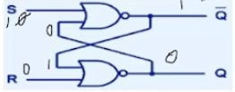

# Circuitos combinacionales y secuenciales

## Diferencias
Mientras que en un circuito combinacional el resultado depende de las entrada actuales, en cambio el secuencial
también depende de salidas previas. Por ejemplo: 

Acá debemos setear una salida antes de empezar con el programa. De lo contrario no tendriamos suficientes
datos para hacer el `NOR`. Véase también que, cuando ambas entradas son 1 y 1, ambos `NOR` largan un 0, lo
que hace imposible que las salidas sean complementarias (Q y Q negado).

### Estabilidad
Un valor estable es un valor que el circuito puede mantener por sí solo, sin que las salidas sigan cambiando.